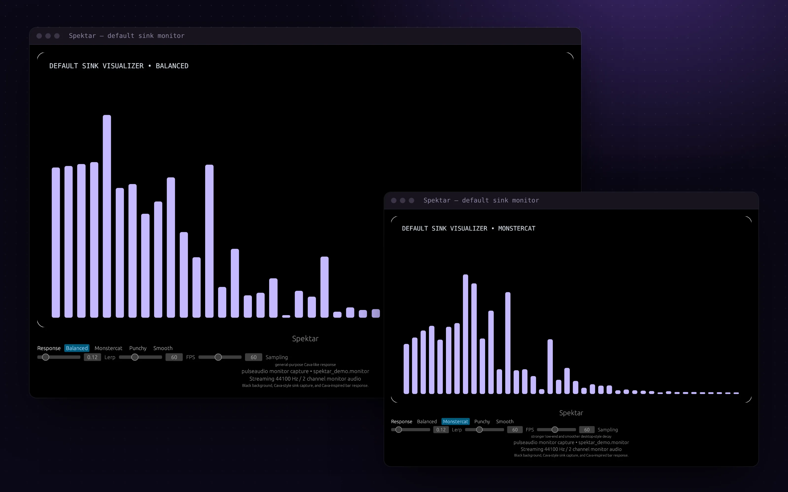
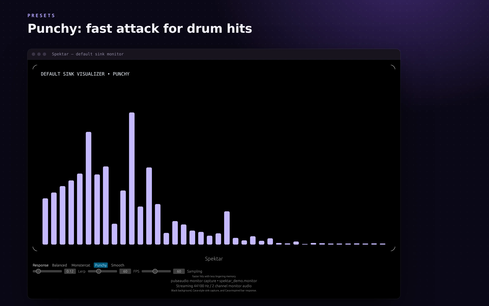
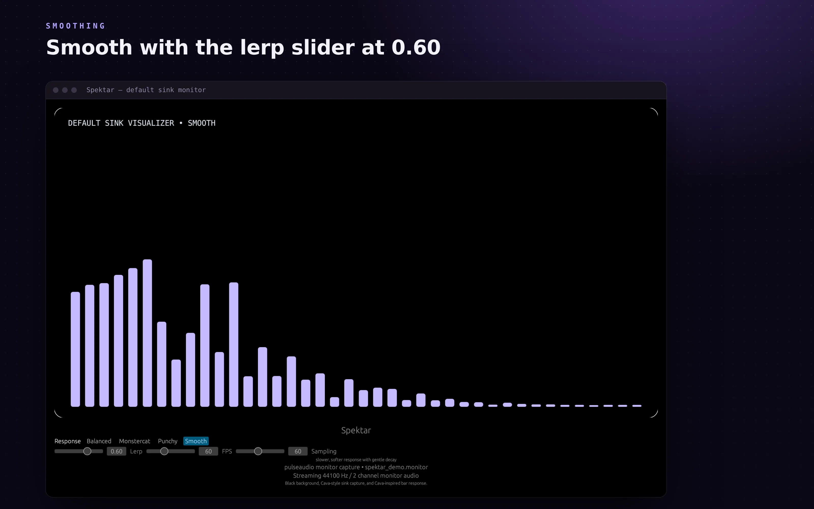
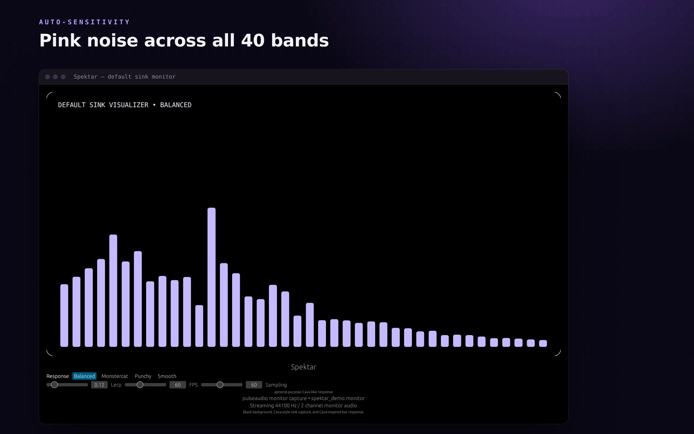

<p align="center">
  
</p>

<p align="center">
  <a href="LICENSE"></a>
  
  <a href="flake.nix"></a>
</p>

<h1 align="center">Spektar</h1>

<p align="center">
  
</p>

<p align="center">
  A real-time audio visualiser for Linux that draws whatever your speakers are playing as frequency bars.
</p>

Spektar listens to the monitor of your default output through PulseAudio (or PipeWire's Pulse layer), runs an FFT over it, and draws 40 bars in an egui window. It started as a way to learn audio capture in Rust and is modelled on [Cava](https://github.com/karlstav/cava), but runs as a desktop window instead of in a terminal.

- **Groups** frequencies into log-spaced bands, so bass and treble each get a fair share of the bars
- **Adjusts** sensitivity on its own, so quiet tracks still move and loud ones don't pin every bar
- **Tunes** the motion with four presets (Balanced, Monstercat, Punchy, Smooth) plus lerp, FPS and sampling sliders

## Quick start

```bash
git clone https://github.com/Fractal-Tess/spektar.git
cd spektar
nix develop -c cargo run --release
```

Play something. Spektar picks up the default sink on its own. Without Nix, see [INSTALL.md](INSTALL.md) for the system libraries it needs.

## A closer look

<table>
  <tr>
    <td></td>
    <td></td>
  </tr>
  <tr>
    <td colspan="2"></td>
  </tr>
</table>

## More

- [INSTALL.md](INSTALL.md): requirements and running without Nix
- [CONTRIBUTING.md](CONTRIBUTING.md): crate layout, debug flags, and how the README images are made

## License

[MIT](LICENSE)
